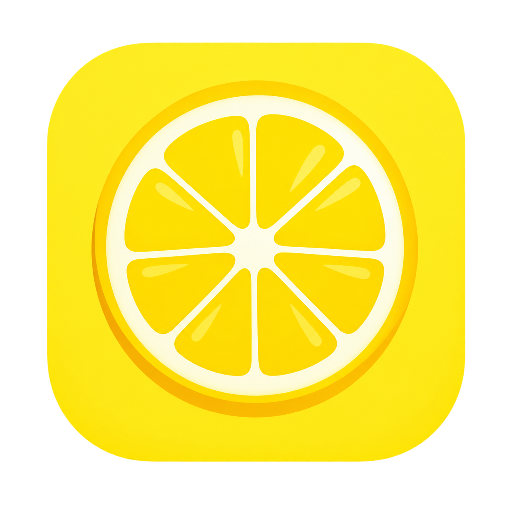
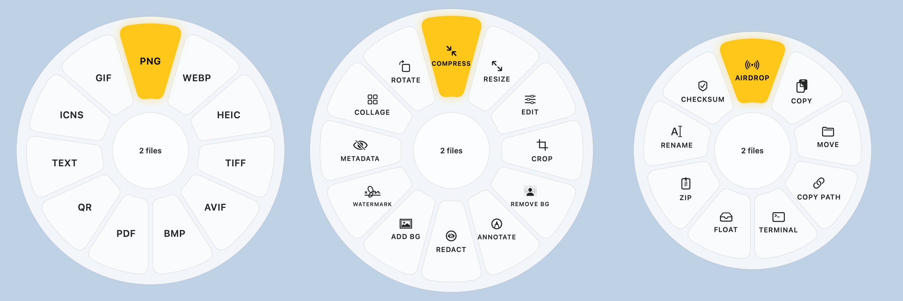

<p align="center">
  
</p>

<h1 align="center">Lemon</h1>

<p align="center">
  <b>Convert, edit and act on any file, right where you drag it.</b><br>
  A native macOS menu bar app with a radial dial of 90+ file tools. Everything runs on your Mac.
</p>

<p align="center">
  
  
  
  
  
</p>

<p align="center">
  
</p>

---

## How it works

Start dragging any file in Finder, then tap a key. A dial of tools blooms around your cursor. Drop the file on a petal and the result is saved right next to the original.

| Key while dragging | Mode | What you get |
|:---:|---|---|
| <kbd>⇧ Shift</kbd> | **Convert** | Every format that file can become |
| <kbd>⌘ Command</kbd> | **Edit** | Compress, crop, trim, redact, protect and more |
| <kbd>⌃ Control</kbd> | **Actions** | AirDrop, Float, Copy, Move, Rename, Checksum |

Switch modes mid-drag by tapping another key. Tools that need a decision (how much to compress, where to crop, which pages to keep) open a small Liquid Glass window with a live preview. Everything else is one drop.

- **Never overwrites.** Results land beside the original as `photo-small.jpg`, `report-1.pdf` and so on.
- **Batch friendly.** Drag 50 files, drop once.
- **One permission prompt.** Allow your Home folder on first launch and Lemon can save next to any file inside it.

## What it can do

<details open>
<summary><b>🖼 Images</b> &nbsp;JPG · PNG · WebP · HEIC · TIFF · AVIF · BMP · SVG in</summary>

- **Convert** to JPG, PNG, WebP, HEIC, TIFF, AVIF, BMP, PDF, ICNS app icons, animated GIF, text (OCR) and QR contents
- **Compress** by quality, to an exact file size, or to a percentage, with a before/after slider
- **Resize** by pixels, percent or presets (4K, 1080p, Story, App icon...), Fit / Fill / Stretch
- **Edit** with 19 live adjustments: exposure, contrast, highlights, shadows, temperature, vibrance, clarity, vignette, grain...
- **Crop** with aspect presets and per-image crops, **Rotate & Flip**
- **Remove background** with Apple Vision, **Add background** with gradients, colours or your own image
- **Annotate** (pen, highlighter, arrows, shapes, text), **Watermark** (text or image, tiled or placed)
- **Redact** with blur, pixelate or solid boxes that can't be reversed
- **Metadata**: see and remove individual EXIF, GPS and camera fields, losslessly where possible
- **Collage** and **OCR to searchable PDF**
</details>

<details>
<summary><b>📄 PDF</b></summary>

- **Convert** to DOCX, PPTX, XLSX, EPUB, Markdown, RTF, TXT, and PNG/JPG pages at 300 dpi
- **Organize** pages: drag to reorder, rotate, delete, duplicate, insert from other files, equalize widths
- **Merge**, **Split**, **Rotate**
- **Compress** by quality or to a target size (images shrink, text stays sharp and searchable)
- **Protect** with passwords and permissions, **Unlock**
- **Watermark**, **Page numbers**, **OCR** scans into searchable PDFs, **Remove metadata**
</details>

<details>
<summary><b>🎬 Video</b> &nbsp;MP4 · MOV · MKV · WebM · AVI · WMV</summary>

- **Convert** between MP4, MOV, MKV, WebM, AVI, WMV and GIF, or extract MP3 / M4A audio
- **Trim**, **Split** (export clips or merged), **Join** with reorder, **Change speed** 0.25x to 4x
- **Compress** with presets or to a target size, H.264 or HEVC with hardware encoding
- **Redact** areas over a time range, **Snapshots** at chosen moments, **Mute**
</details>

<details>
<summary><b>🎧 Audio</b> &nbsp;MP3 · M4A · WAV · FLAC · OGG · Opus · AIFF · WMA</summary>

- **Convert** between all eight formats
- **Trim** with automatic silence removal, **Change speed** with pitch kept
- **Normalize loudness** to streaming, podcast or broadcast targets (EBU R128)
- **Bleep** ranges, **Channels** (mono, stereo, left/right balance), **Audio to video** with waveform or image
</details>

<details>
<summary><b>📝 Documents, slides & sheets</b></summary>

- **Documents**: DOCX, ODT, RTF, RTFD, HTML, Markdown, TXT, EPUB and text clippings to PDF, DOCX, RTF, HTML, ODT, Markdown, EPUB, TXT
- **Slides**: PPTX / PPT to PDF, JPG, PNG, rendered by Lemon itself
- **Spreadsheets**: XLSX, XLS, ODS, CSV, TSV to XLSX, ODS, CSV, TSV, PDF
- **Subtitles**: SRT ↔ VTT, and plain-text transcripts
</details>

<details>
<summary><b>🗂 Archives & everything else</b></summary>

- **Archives**: extract ZIP, TAR, GZ, BZ2, XZ, 7z, RAR; convert between ZIP, TAR and GZIP
- **Actions for any file or folder**: AirDrop, Copy, Move, Copy Path, Open in Terminal, ZIP
- **Batch rename** with `{name}`, `{n}` and `{date}` patterns, find & replace, case changes, live preview and conflict checks
- **Checksum** (SHA-256, SHA-1, MD5) with paste-to-compare
- **Float**: a glass shelf that docks to a screen edge and holds files until you drag them out again
</details>

## Built for macOS

- **Native everywhere.** SwiftUI and AppKit, Liquid Glass windows and controls on macOS 26, a lemon-slice menu bar icon that follows light and dark mode.
- **Private by design.** No accounts, no uploads, no analytics. The app is sandboxed and writes only where you allow it.
- **Apple frameworks first.** ImageIO, Core Image, Vision, PDFKit, AVFoundation and VideoToolbox do the heavy lifting, with hardware acceleration.
- **One bundled helper.** A static, LGPL-only ffmpeg covers the formats Apple doesn't encode (MP3, OGG, Opus, WMA, MKV, WebM, AVI, WMV, WebP). It runs inside Lemon's sandbox and only sees the files Lemon hands it.

## Install from source

**Requirements:** an Apple silicon Mac on macOS 14 or later, the Xcode command line tools (Swift 5.10+), and `pkg-config` for the one-time ffmpeg build (`brew install pkgconf`).

```sh
git clone git@github.com:WaniAthar/Lemon.git
cd Lemon

# 1. Build the bundled ffmpeg once (downloads official sources, ~5 minutes)
scripts/build-ffmpeg.sh

# 2. Build, sign (ad hoc) and bundle the app
scripts/build-app.sh

# 3. Run it
open build/Lemon.app
```

On first launch Lemon asks for access to your Home folder so it can save results next to your files. You can add or remove folders later in **Settings**.

## Testing

Lemon carries its own end-to-end test suite. It generates sample images, PDFs, documents, audio and video, runs every tool on them and checks the results down to the pixel: redaction is irreversible, OCR text is findable, target sizes are met, and so on.

```sh
swift build && .build/debug/Lemon --selftest
# or inside the sandboxed app bundle
build/Lemon.app/Contents/MacOS/Lemon --selftest
```

Add `--render path.png` to also render the dial and every editor window offscreen for a quick visual check.

## Project layout

```
Sources/Lemon/
  LemonApp.swift       app, menu bar item, settings
  Fan.swift            the radial dial, drag detection, toasts
  Tools.swift          the tool registry and file-type routing
  Engines.swift        core image, PDF, document and archive engines
  FFmpeg.swift         bundled ffmpeg runner and presets
  Editors.swift        shared window chrome plus Crop, Compress, Rotate
  *Editors.swift       editor windows for each pack (image, media, PDF, extras)
  *Engine.swift        engines for each pack
  Office.swift, Sheets.swift, Slides.swift, Zip.swift   document formats
  FloatShelf.swift     the Float shelf
  *SelfTest.swift      the test suite
scripts/               build-app.sh, build-ffmpeg.sh
Support/               Info.plist, entitlements, icons, third-party licences
TOOLS.md               the full tool and option catalog
```

## Licenses

Lemon bundles ffmpeg 7.1.1 built from source as a separate executable, under the **LGPL 2.1** with no GPL or non-free components. It includes LAME (LGPL), Opus, Vorbis, Ogg, libvpx and libwebp (BSD). Their licence texts ship inside the app under `Contents/Resources/Licenses`, and `scripts/build-ffmpeg.sh` reproduces the exact build.

<p align="center"><sub>Made with 🍋 for people who move a lot of files around.</sub></p>
